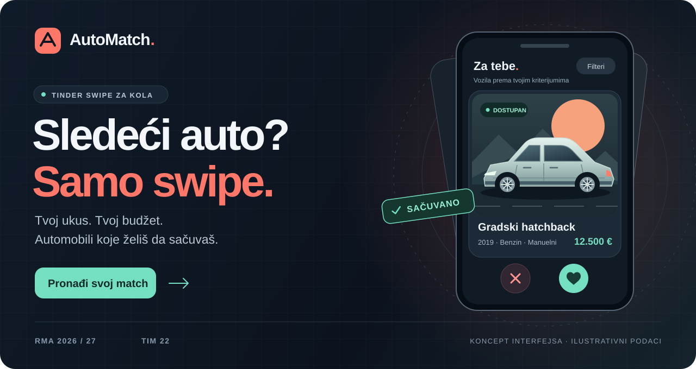
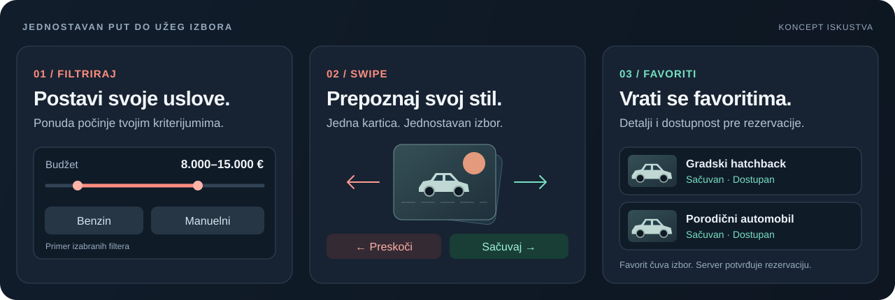
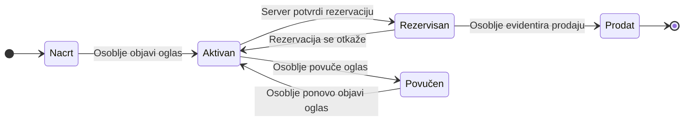
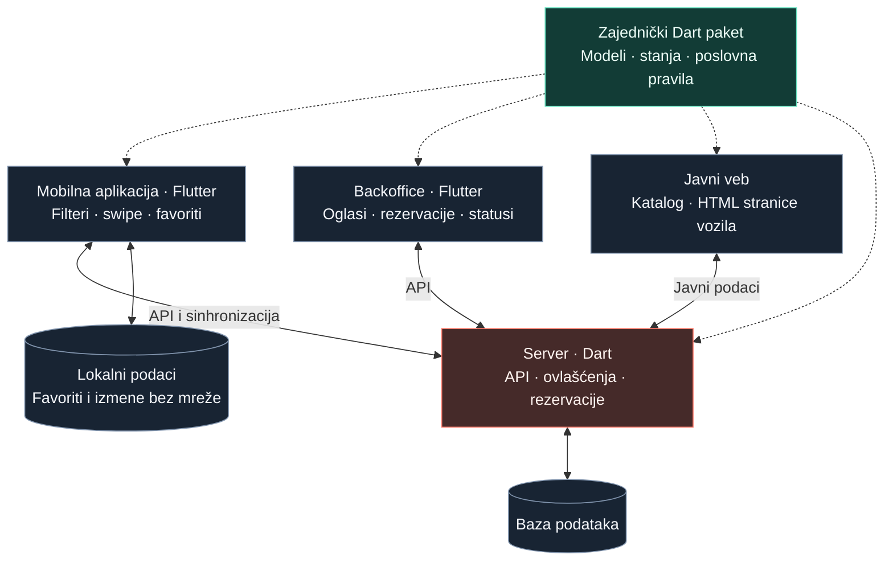

  

<h1 align="center">AutoMatch · Tinder swipe za kola</h1>

  <strong>Manje skrolovanja. Više dobrih izbora.</strong> 
  Podesi kriterijume, prevuci karticu i sačuvaj automobile koji ti stvarno odgovaraju.

  
  
  
  

> **Faza projekta:** prijava teme i planiranje. Ovaj README opisuje predloženo rešenje; funkcionalnosti i ekrani predstavljaju plan, a ne već implementiranu aplikaciju. Referenca je [projektni zadatak](Projektni%20zadatak%20-%20Razvoj%20multiplatformskih%20aplikacija.docx), objava od 1. 10. 2026.

## Tvoj sledeći auto, jedan swipe bliže

Kupovina automobila često počinje sa deset otvorenih tabova i oglasima koji se ponavljaju. **AutoMatch** pretvara tu potragu u jednostavno, interaktivno iskustvo inspirisano Tinder swipe mehanikom: prvo odrediš šta tražiš, a zatim biraš između vozila koja odgovaraju tvojim kriterijumima.

Prevlačenje ulevo preskače automobil. Prevlačenje udesno čuva ga u favoritima. Kada pronađeš pravi izbor, otvaraš detalje i možeš da zatražiš rezervaciju dostupnog vozila. **„Match” označava tvoj izbor automobila; čuvanje u favorite samo po sebi ne rezerviše vozilo.**

Ideja je namenjena ljudima koji žele da lakše pronađu i sačuvaju automobile prema svojim potrebama i budžetu, kao i osoblju koje održava ponudu i obrađuje rezervacije.

## Od kriterijuma do favorita

  

| Korak | Šta korisnik radi |
| :--- | :--- |
| **01 · Podesi kriterijume** | Bira raspon cene, marku i model, godište, kilometražu, gorivo i menjač. |
| **02 · Pronađi svoj match** | Pregleda kartice sa fotografijom, cenom i ključnim karakteristikama. Ulevo preskače, udesno čuva; iste radnje dostupne su i preko dugmadi. |
| **03 · Vrati se najboljim izborima** | Otvara sačuvana vozila, proverava detalje i dostupnost, pa za odabrano vozilo šalje zahtev za rezervaciju. |

### Šta čini osnovu aplikacije

- **Ponuda prema tvojim kriterijumima.** Filteri su polazna tačka za izbor vozila.
- **Jedno vozilo u fokusu.** Kartica izdvaja podatke potrebne za prvi izbor, dok su ostale informacije na ekranu detalja.
- **Favoriti na jednom mestu.** Sačuvani automobili ostaju dostupni za kasniji pregled i odluku.
- **Čuvanje i bez signala.** Već učitano vozilo možeš dodati u favorite ili ukloniti iz njih bez mreže; izmena se usklađuje sa serverom po povratku veze.
- **Jasna dostupnost.** Rezervaciju potvrđuje server, uz proveru da vozilo u međuvremenu nije rezervisano ili prodato.
- **Backoffice za osoblje.** Tabelarni pregled oglasa i rezervacija, pretraga, filtriranje i upravljanje statusima na većem ekranu.

## Šest zahteva, jedno povezano rešenje

Tema se oslanja na **oglas automobila** kao glavni domenski pojam. Rezervacija povezuje korisnički izbor sa dostupnošću vozila i poslom osoblja.

| Zahtev iz specifikacije | Kako ga AutoMatch ispunjava |
| :--- | :--- |
| **1. Najmanje dve uloge** | **Korisnik** pregleda vozila, upravlja svojim favoritima i traži rezervaciju. **Osoblje** upravlja oglasima, dostupnošću i rezervacijama kroz backoffice, uz ovlašćenja koja korisnik nema. |
| **2. Najmanje četiri stanja** | Oglas prolazi kroz stanja **nacrt, aktivan, rezervisan, prodat i povučen**. Status određuje da li je oglas javno dostupan i koje su sledeće radnje dozvoljene. |
| **3. Poslovna pravila i odluka servera** | Samo aktivan oglas može da se rezerviše, a isto vozilo može imati najviše jednu aktivnu rezervaciju. Pošto dva korisnika mogu istovremeno tražiti isto vozilo, server u jednoj transakciji proverava dostupnost i upisuje rezervaciju. |
| **4. Izmena bez mreže** | Korisnik može da doda već učitano vozilo u favorite ili ga ukloni iz njih bez interneta. Promena se čuva lokalno i sinhronizuje po povratku veze, dok rezervacija zahteva vezu i potvrdu servera. |
| **5. Posao za osoblje na većem ekranu** | Backoffice omogućava rad sa većim brojem oglasa i rezervacija kroz tabele, filtere i pretragu. Osoblje objavljuje oglase, ažurira podatke i obrađuje promene statusa vozila. |
| **6. Javni sadržaj za pretraživače** | Javni veb prikazuje katalog i pojedinačne stranice objavljenih vozila bez prijave, sa opisom, cenom, karakteristikama i dostupnošću. Sadržaj se isporučuje kao HTML koji pretraživači mogu da indeksiraju. |

### Ko može šta

| Radnja | Posetilac bez prijave | Korisnik | Osoblje |
| :--- | :---: | :---: | :---: |
| Pregled javnog kataloga i detalja vozila | ✓ | ✓ | ✓ |
| Upravljanje sopstvenim favoritima | — | ✓ | — |
| Slanje i otkazivanje sopstvene aktivne rezervacije | — | ✓ | — |
| Kreiranje, uređivanje i objavljivanje oglasa | — | — | ✓ |
| Pregled svih rezervacija i upravljanje statusima | — | — | ✓ |

Posetilac predstavlja javni pristup bez naloga; dve aplikativne uloge su korisnik i osoblje. Server proverava ovlašćenja i vlasništvo nad privatnim podacima pri svakoj zaštićenoj operaciji.

### Životni ciklus oglasa

**Primer pravila između korisnika:** Ana i Marko pokušavaju da rezervišu isto vozilo. Ako server prvo potvrdi Aninu rezervaciju, Markov zahtev se odbija jer vozilo više nije aktivno. Dugme u aplikaciji nije dovoljna zaštita: provera i upis moraju biti jedna celina na serveru.

Nacrti i povučeni oglasi nisu javni. Aktivni, rezervisani i prodati oglasi mogu imati javnu stranicu sa jasno naznačenim statusom, ali se samo aktivni nude za novo rezervisanje. Podaci o korisniku koji je rezervisao vozilo nisu deo javne stranice.

## Četiri dela sistema. Zajednički Dart domen.

Arhitektura prati projektni zadatak: mobilna aplikacija, backoffice, server i javni veb dele isti domenski kod napisan u Dartu.

Isprekidane strelice označavaju korišćenje zajedničkog paketa, a pune razmenu podataka. Zajednički domen opisuje modele, stanja i pravila koja ne zahtevaju pristup bazi; server konačno proverava ovlašćenja i pravila koja zavise od podataka drugih korisnika.

| Deo | Odgovornost |
| :--- | :--- |
| **Mobilna aplikacija** | Izbor automobila kroz filtere i swipe, detalji, favoriti i zahtevi za rezervaciju. |
| **Backoffice** | Pregled ponude i rezervacija, uređivanje oglasa i upravljanje životnim ciklusom vozila. |
| **Server** | Čuvanje podataka, autentifikacija, autorizacija i dosledno sprovođenje pravila. |
| **Javni veb** | Katalog i indeksabilne stranice vozila dostupne bez prijave. |
| **Domenski paket** | Zajednički modeli kao što su oglas, filteri, favorit i rezervacija, sa pripadajućim stanjima i validacijom. |

Flutter i Dart polaze od zahteva predmeta. Konkretna baza, serverski i veb okvir biće izabrani tokom odgovarajućih kontrolnih tačaka.

### Kada nestane mreže

1. Aplikacija prikazuje prethodno učitane podatke dostupne lokalno.
2. Dodavanje ili uklanjanje favorita odmah menja lokalno stanje i označava izmenu kao nesinhronizovanu.
3. Po povratku veze aplikacija šalje izmene serveru; ponovljeno slanje iste željene vrednosti ne pravi duplikate.
4. Osvežava se dostupnost vozila. Ako je automobil prodat u međuvremenu, favorit može ostati sačuvan uz novi status, a rezervacija nije dostupna.

Uspešno poslate izmene uklanjaju se iz reda za sinhronizaciju tek posle potvrde servera. Bez mreže nema potvrđivanja rezervacije niti obećanja da je vozilo i dalje dostupno.

## Tim 22

| Član | Broj indeksa | GitHub |
| :--- | :--- | :--- |
| **Nikola Mitrović** | SI 95/24 | [@MitaKrempita](https://github.com/MitaKrempita) |
| **Aljoša Kovačević** | SI 89/24 | [@v0idpointer](https://github.com/v0idpointer) |

**Predmet:** Razvoj multiplatformskih aplikacija · Softversko inženjerstvo, IV godina  
**Oznaka tima:** `tim-22` · **Grupe:** 412/413  
**Prijavljena tema:** Tinder swipe za kola · **Radni naziv aplikacije:** AutoMatch

---

  <strong>AutoMatch</strong> 
  Tvoj ukus. Tvoj budžet. Tvoj sledeći auto.

